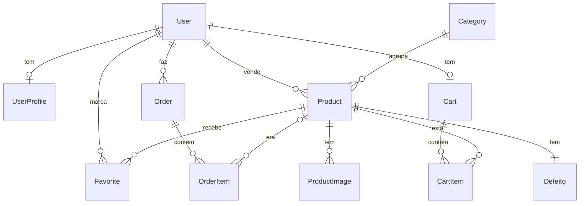

# FioFora — documentação do aplicativo

Aplicativo Django do FioFora: vitrine de peças com pequenos defeitos, em que o
desconto é calculado pela gravidade do defeito.

## Sumário

1. [Instalação](#instalação)
2. [Como o Django funciona aqui](#como-o-django-funciona-aqui)
3. [Estrutura de pastas](#estrutura-de-pastas)
4. [Apps](#apps)
5. [Banco de dados](#banco-de-dados)
6. [Conceitos aplicados](#conceitos-aplicados)
7. [Comandos úteis](#comandos-úteis)

---

## Instalação

### 1. Instalar o Python

Baixe no site oficial: <https://www.python.org/downloads/>.

| Sistema | Como instalar |
|---|---|
| Windows | Rode o instalador e marque **Add python.exe to PATH** |
| macOS | Rode o instalador `.pkg` |
| Ubuntu / Debian / Pop!_OS | `sudo apt install python3 python3-pip python3-venv` |
| Fedora | `sudo dnf install python3 python3-pip` |

Confira com `python3 --version` (no Windows, `python --version`).

### 2. Primeira vez

Dentro da pasta `fio-fora`:

**Codespace, Linux e macOS**

```bash
python3 -m venv .venv
source .venv/bin/activate
pip install -r requirements.txt
python manage.py migrate
python manage.py popular_banco
python manage.py runserver
```

**Windows (PowerShell)**

```powershell
python -m venv .venv
.venv\Scripts\Activate.ps1
pip install -r requirements.txt
python manage.py migrate
python manage.py popular_banco
python manage.py runserver
```

Abra <http://127.0.0.1:8000/>. A página inicial é o login; a vitrine fica em
`/vitrine/`. Para parar o servidor, use `Ctrl+C`.

### 3. Próximas vezes

```bash
cd fio-fora
source .venv/bin/activate        # Windows: .venv\Scripts\Activate.ps1
python manage.py migrate         # aplica mudanças que vieram do git pull
python manage.py runserver
```

### Contas para testar

- **Usuário comum:** crie pela tela de cadastro (`/cadastro/`). Os usuários
    criados pelo `popular_banco` não têm senha e servem só como dados de exemplo.
- **Administrador** (para `/admin/` e `/usuarios/`): `python manage.py createsuperuser`.

### Problemas comuns

| Problema | Solução |
|---|---|
| `python: command not found` com o `.venv` ativo | O `.venv` foi criado em outra pasta. Apague (`rm -rf .venv`) e crie de novo dentro de `fio-fora`. |
| `That port is already in use` | Já há um servidor rodando. Pare com `Ctrl+C` ou use `python manage.py runserver 8001`. |
| Erro de tabela ou migration depois de atualizar | Seu `db.sqlite3` é de uma versão antiga. Apague-o e rode `migrate` e `popular_banco` de novo. |

---

## Como o Django funciona aqui

O Django organiza o código no padrão **MTV** (Model, Template, View):

```text
Navegador → URL → View → Model (banco) → Template (HTML + CSS) → Navegador
```

| Peça | Arquivo | Papel |
|---|---|---|
| URL | `urls.py` | Liga um endereço a uma view |
| View | `views.py` | Recebe a requisição, busca os dados e escolhe o template |
| Model | `models.py` | Define as tabelas do banco e as regras dos dados |
| Form | `forms.py` | Valida o que o usuário envia |
| Template | `templates/` | HTML que a pessoa vê |
| Static | `static/` | CSS, imagens e fontes |

Exemplo, a vitrine:

1. `products/urls.py` liga `/vitrine/` à view `home`.
2. `home`, em `products/views.py`, busca as peças ativas no model `Product`.
3. A view renderiza `products/home.html`, que herda o layout de `templates/base.html`.

### Projeto e apps

- **Projeto** (`config/`): só configuração. Em `settings.py` ficam os apps
    instalados, o banco e as pastas de templates e static; `urls.py` só
    encaminha para as URLs de cada app.
- **App**: uma área do site, com tudo o que ela precisa. Cada app tem a mesma
    estrutura (veja abaixo).

---

## Estrutura de pastas

```text
fio-fora/
├── manage.py
├── requirements.txt
├── config/                 # Configuração do projeto
├── templates/              # HTML compartilhado
│   ├── base.html           # Layout: <head>, cabeçalho e mensagens
│   └── components/         # Pedaços reutilizáveis
├── static/                 # CSS, ícones, fontes e logo compartilhados
│   └── css/site.css        # Importa os CSS gerais
├── accounts/               # Contas e permissões
├── products/               # Catálogo e área do vendedor
├── cart/                   # Carrinho
├── orders/                 # Checkout e pedidos
└── favorites/              # Favoritos
```

Todo app segue este formato:

```text
<app>/
├── models.py  views.py  urls.py  forms.py  admin.py  tests.py
├── migrations/
├── templates/<app>/        # O nome do app se repete para não haver conflito
│   └── includes/           # Pedaços do app usados em outras páginas
└── static/<app>/css/
```

### Componentes compartilhados (`templates/components/`)

| Arquivo | Uso |
|---|---|
| `header.html` | Cabeçalho único; mostra links conforme o tipo de conta |
| `messages.html` | Mensagens de sucesso e erro (já incluído no `base.html`) |
| `form_fields.html` | Todos os campos de um formulário |
| `field.html` | Um campo de formulário |
| `pagination.html` | Paginação de listas |
| `logo.html` | Logo |

> **[PRINT]** Cabeçalho do site logado como vendedor, mostrando os links "Minhas peças" e "Cadastrar peça".

---

## Apps

| App | O que faz | Documentação |
|---|---|---|
| `accounts` | Login, cadastro (comprador, vendedor, marca), perfil, recuperação de senha, permissões e lista de usuários | [accounts/README.md](accounts/README.md) |
| `products` | Vitrine, filtro por severidade, página da peça, área do vendedor e simulador de desconto | [products/README.md](products/README.md) |
| `cart` | Carrinho do comprador, com validação de estoque | [cart/README.md](cart/README.md) |
| `orders` | Checkout simulado e histórico de pedidos | [orders/README.md](orders/README.md) |
| `favorites` | Peças favoritas do usuário | [favorites/README.md](favorites/README.md) |

### Tipos de conta

| Tipo | Pode |
|---|---|
| Comprador | Comprar (carrinho, checkout, pedidos) e favoritar |
| Vendedor / Marca | Cadastrar, editar e remover as próprias peças |
| Equipe (staff) | Tudo acima, além do Admin e da lista de usuários |

---

## Banco de dados

O projeto usa **SQLite** (arquivo `db.sqlite3`, fora do git). Cada pessoa tem o
seu banco local.



| Model | App | Guarda |
|---|---|---|
| `User` | Django | Login (e-mail e senha) |
| `UserProfile` | accounts | Tipo de conta, telefone, loja, documento |
| `Product` | products | Peça: nome, preços, estoque, vendedor |
| `Defeito` | products | Tipo, localização e extensão do defeito |
| `Category`, `ProductImage` | products | Categoria e fotos da peça |
| `Cart`, `CartItem` | cart | Carrinho e seus itens |
| `Order`, `OrderItem` | orders | Pedido e cópia do nome e preço de cada item |
| `Favorite` | favorites | Peça favoritada por um usuário |

Regras importantes:

- **O preço final é calculado**, nunca digitado: vem da severidade do `Defeito`.
- **O pedido guarda uma cópia** do nome e do preço do item, para o histórico não
    mudar se a peça mudar ou for apagada.
- **Apagar uma peça** apaga o defeito, as fotos, os favoritos e os itens de
    carrinho dela, mas mantém os pedidos.

> **[PRINT]** Tela do Django Admin (`/admin/`) com a lista de produtos.

---

## Conceitos aplicados

- **Herança de templates:** toda página faz `` (ou o
    `base.html` do app) e preenche o bloco `content`.
- **Includes:** pedaços repetidos ficam em `components/` ou em `<app>/includes/`
    e entram com ``.
- **Namespace de templates e static:** `products/templates/products/home.html`
    é referenciado como `products/home.html`.
- **Decorators de permissão:** `@seller_required` e `@buyer_required`, em
    `accounts/decorators.py`, protegem as views.
- **Context processor:** `is_buyer` e `is_seller` ficam disponíveis em todos os
    templates.
- **Services:** regras usadas por mais de um app ficam em `services.py`
    (por exemplo, `cart/services.py` é usado pelo checkout).
- **ModelForm:** formulários gerados a partir do model, com validação.
- **Migrations:** registram as mudanças nos models; nunca são editadas à mão.
- **Testes:** cada app tem o seu `tests.py`.

---

## Comandos úteis

| Comando | Para quê |
|---|---|
| `python manage.py runserver` | Inicia o servidor |
| `python manage.py migrate` | Aplica as migrations no banco |
| `python manage.py makemigrations` | Cria migrations depois de mudar um model |
| `python manage.py test` | Roda todos os testes |
| `python manage.py test products` | Roda os testes de um app |
| `python manage.py popular_banco` | Cria dados de exemplo (pode rodar de novo sem duplicar) |
| `python manage.py createsuperuser` | Cria um administrador |
| `python manage.py check` | Verifica se há erros de configuração |
